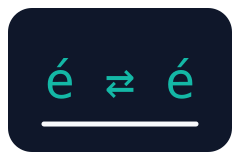

<div align="center">


[](LICENSE)




**Compare Unicode normalization forms and inspect their resulting code points.**

</div>

## ✨ Overview

A local Unicode workbench powered by Python's built-in Unicode database module. It helps explain canonical and compatibility normalization.

## 🚀 Features

- 🔤 Compares NFC, NFD, NFKC, and NFKD.
- 🧭 Shows code points, Unicode names, and categories.
- 🧪 Highlights whether each form changes the input.
- 🔒 Processes text locally without network access.

## 🧪 Demo

```bash
python main.py 'é'
python main.py 'ffi' --form NFKC
```

## ⚡ Quick Start

```bash
git clone https://github.com/CyberLoop-dev/unicode-normalization-lab.git
cd unicode-normalization-lab
python main.py 'é'
```

## 🧰 Tech Stack

Python 3.10+ · Standard library only.

## 🗂️ Folder Structure

```text
unicode-normalization-lab/
├── main.py
├── tests/test_main.py
├── requirements.txt
├── .github/workflows/tests.yml
└── assets/mark.svg
```

## 🗺️ Roadmap

- [x] Four standard normalization forms
- [x] Code-point inspection and tests
- [ ] Side-by-side visual character diff
- [ ] Text-file batch mode

## 🤝 Contributing

Add examples that demonstrate a specific Unicode normalization behavior and include expected output in tests.

## 📄 License

MIT — see [LICENSE](LICENSE).

<div align="center"></div>
